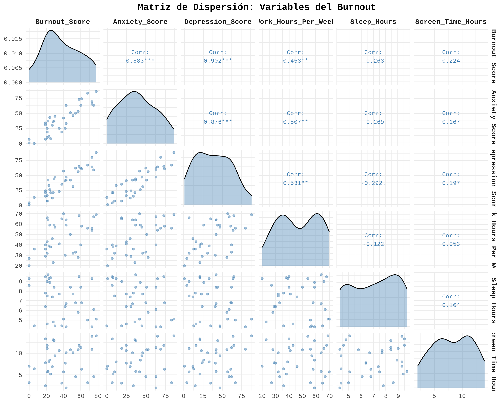
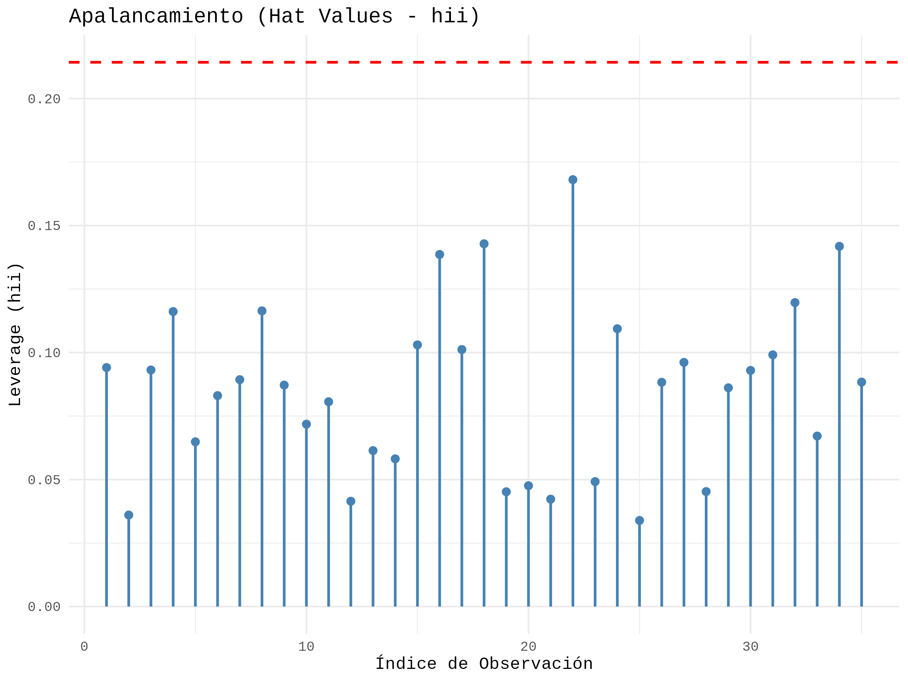
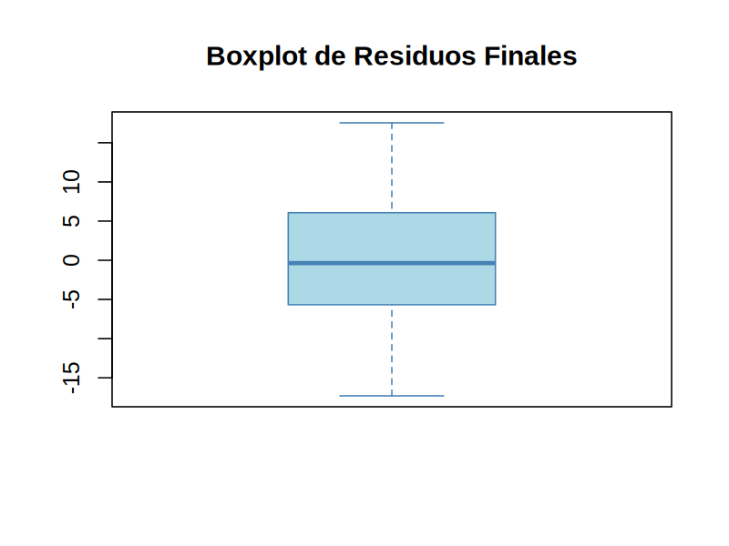

# Modelado Estadístico del Desgaste Laboral (Burnout) 

Análisis de regresión lineal simple y múltiple sobre una muestra de 35 registros para identificar qué variables predicen el Burnout Score, cuantificar su impacto y validar el modelo mediante diagnóstico de supuestos, selección de variables y análisis de outliers.

## Problema

El dataset de Burnout registra 6 variables cuantitativas por individuo. El objetivo fue determinar:

1. Qué variables se relacionan linealmente con el Burnout Score.
2. Si esas variables dicen cosas distintas o se superponen (multicolinealidad).
3. Cuál es el modelo más eficiente y robusto para predecir el desgaste laboral.

## Datos

- **Fuente:** `burnout_tp.csv` (dataset de cátedra).
- **Muestra final:** 35 registros (subconjunto aleatorio, semilla = 8).
- **Variables:** 6 cuantitativas.
- **Variable respuesta:** `Burnout_Score`.

## Métodos

### Análisis exploratorio (`01_analisis_principal.R`)
- Estadísticos descriptivos: tendencia central, dispersión y forma.
- Matriz de dispersión y matriz de correlaciones de Pearson con test de hipótesis.
- Detección de relaciones lineales fuertes con el Burnout Score.

### Modelado simple (`01_analisis_principal.R`)
- Regresión lineal simple con la variable más correlacionada.
- Intervalos de confianza al 99%.
- Test de nulidad y test unilateral de pendiente positiva.
- ANOVA y coeficiente de determinación (R² ajustado).
- Diagnóstico de supuestos: normalidad (Shapiro-Wilk), homocedasticidad (Breusch-Pagan) e independencia (Durbin-Watson).

### Modelado múltiple y multicolinealidad (`01_analisis_principal.R`)
- Regresión lineal múltiple con los predictores asociados.
- Diagnóstico de VIF (Factor de Inflación de Varianza).
- Reajuste del modelo eliminando variables no significativas.

### Selección de variables y diagnóstico avanzado (`01_analisis_principal.R`)
- Procedimiento de **todos los subconjuntos posibles** (`ols_step_all_possible`).
- Comparación de métricas: R² ajustado, Cp de Mallows, AIC, SBIC.
- Análisis de outliers bajo tres criterios: leverage, distancia de Cook y test de Bonferroni.
- Transformación Box-Cox para evaluar la necesidad de reescalar la variable respuesta.

### Exportación de resultados (`02_exportar_tablas_figuras.R`)
- Generación automática de carpetas `outputs/tablas` y `outputs/figuras`.
- Exportación de tablas en CSV y summaries en TXT.
- Exportación de figuras en PNG con alta resolución (300 dpi).

## Hallazgos principales

1. **Dos variables discriminan:** `Depression_Score` (r = 0.90) y `Anxiety_Score` (r = 0.88) son los predictores más fuertes. `Work_Hours_Per_Week` muestra asociación moderada que no se sostiene en el modelo múltiple.
2. **El modelo final explica el 84,24% de la variabilidad** del Burnout Score (R² ajustado = 0.8424), usando solo ansiedad y depresión.
3. **La depresión es el predictor más influyente** (β = 0.54), seguida por la ansiedad (β = 0.37).
4. **Las horas trabajadas no aportan valor predictivo** una vez controlada la salud mental: el burnout es más un problema de bienestar psicológico que de carga horaria.
5. **El modelo es estadísticamente robusto:** cumple los tres supuestos (normalidad, homocedasticidad, independencia), no presenta outliers influyentes y no requiere transformación Box-Cox (λ óptimo ≈ 0.91).

## Visualizaciones

## Contacto

- **Autor:** Augusto Barzola
- **GitHub:** [@augusbarzola-arch](https://github.com/augusbarzola-arch)
- **LinkedIn:** [tu perfil](https://linkedin.com/in/tu-perfil)
- **Email:** augus.barzola@gmail.com
